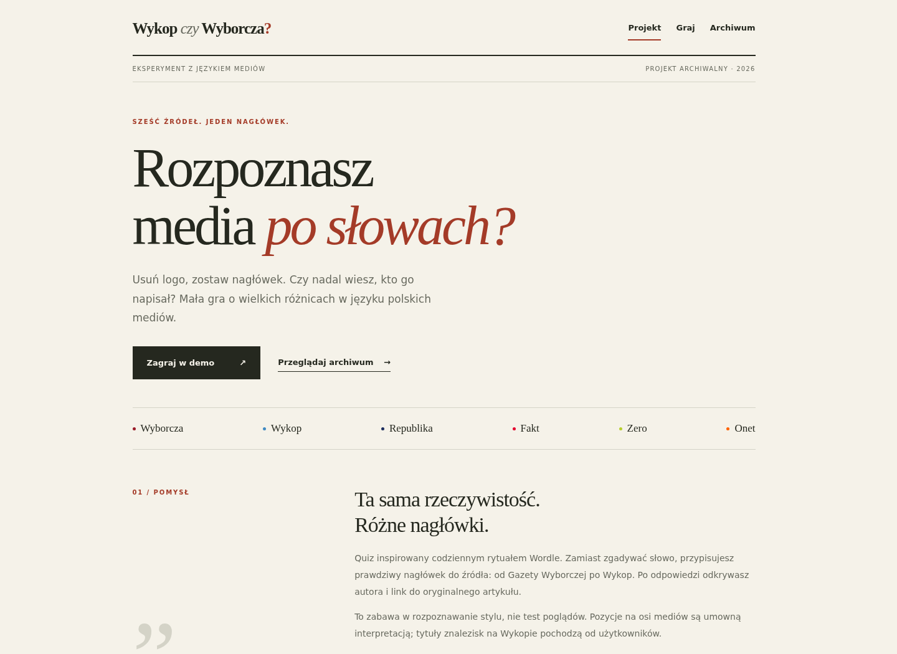

# Wykop czy Wyborcza?

**An archived, playable experiment in the language of Polish media.** Remove the
logo from a real headline and guess its source: Gazeta Wyborcza, Wykop,
TV Republika, Fakt, Zero.pl or Onet.

[Play / portfolio](https://110kc3.github.io/puzle/) ·
[Puzzle archive](https://110kc3.github.io/puzle/#/archiwum) ·
[Project status](TODO.md)



## Preserved as a portfolio

The original project combined a Wordle-style daily puzzle with an endless mode.
As of **19 October 2026**, it is a static portfolio and playable archive:

- **56 published puzzles**, dated 6 July–18 September 2026, grouped by month.
- **300 saved headlines** in random mode, with a restart after the pool is exhausted.
- Source attribution, article links, keyboard controls and local progress remain.
- A new editorial landing page explains the idea, interaction and architecture.
- No scheduled gathering, publishing, queue maintenance or external stats service.

The twice-daily `Daily puzzle` Action was failing on an empty curation queue and
producing repeated failure emails. It was disabled on GitHub and its workflow
removed. The only remaining Action tests, builds and deploys Pages on a push to
`main` or a manual dispatch. There are no recurring jobs. The repository stays
writable so the portfolio can still be maintained; it is not GitHub's read-only
repository archive setting.

Existing `#/d/YYYY-MM-DD` links still work. The old `#/dzienna` route opens the
last published puzzle without fetching a nonexistent puzzle for today. The home
route now presents the project; random play is at `#/gra`. Saved browser progress
uses the original storage key. Historical streaks are retained; archive play does
not extend them. Sharing an archive result links directly to that puzzle.

## Design and architecture

**Interaction:** six possible sources, a single choice, then a reveal with the
source, original article link, optional image and an approximate media axis.
The axis is an editorial interpretation, not an objective political measure.
Wykop headlines are user-submitted link titles.

**Data:** the original Node/TypeScript pipeline gathered RSS and HTML headlines,
enriched them with article images and prepared a manually curated daily queue.
Answers and URLs use XOR/base64 obfuscation to avoid accidental spoilers; this is
not encryption. Puzzle-specific source ordering preserves older four-source games.

**Delivery:** React 19, TypeScript, Vite and Tailwind CSS on GitHub Pages.
Gameplay uses committed JSON and browser storage. Remote article links and images
may age; broken images disappear without preventing play. No article bodies are
stored. No account, backend or Cloudflare deployment is required.

## Development

Use **Node 22** (the same major version as Actions).

```sh
npm ci
npm run dev        # http://localhost:5173/puzle/
npm test -- --reporter=dot
npm run typecheck
npm run build
npm run preview    # preview the production build
```

Tests cover dates, obfuscation, streaks, share text, outlet configuration and the
integrity of every archived puzzle and random-pool reveal. The completed archive
conversion was also checked in Chromium at desktop, tablet and 320/375px mobile
widths, in light/dark themes, with remote images blocked.

## Repository map

| Path | Purpose |
| --- | --- |
| `src/components/ShowcasePage.tsx` | Portfolio landing page |
| `src/components/ArchivePage.tsx` | Monthly archive |
| `src/components/InfinitePage.tsx` | Random play from the frozen pool |
| `src/lib/collection.ts` | Archive dates and entries derived from the saved index |
| `public/puzzles/` | Published puzzles, index and random pool |
| `config/outlets.ts` | Source identities, colors and approximate media positions |
| `scripts/`, `data/` | Historical gathering/publishing tooling and curation data |
| `worker/` | Historical optional statistics service; disconnected from the portfolio |
| `.github/workflows/deploy.yml` | Test, typecheck, build and deploy on change |

## Maintenance

Pages must use **GitHub Actions** as its source. Push to `main` or manually run
`Deploy Pages` to update the portfolio. No daily ritual is required.

The original `npm run gather` and `npm run publish:daily` commands remain for
historical reference and deliberate local use. They mutate the saved collection;
do not run them as part of routine portfolio upkeep. There is no active content
queue. Original, unselected expansion ideas are preserved in [TODO.md](TODO.md).
The Cloudflare code and original setup notes remain in [worker/README.md](worker/README.md);
no existing Cloudflare resources were modified or deleted.
